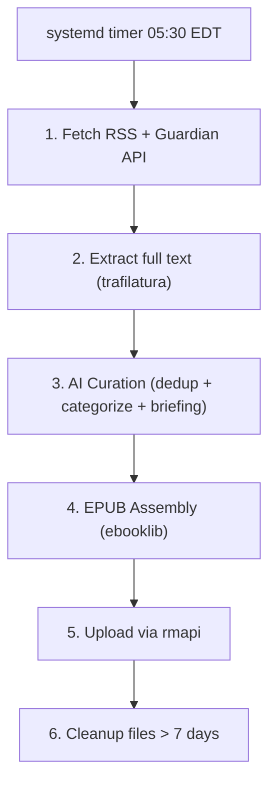

# remarkable-morning

Daily news digest pipeline for reMarkable Paper Pro. Fetches 19 sources across EN/DE/FR, curates via LLM, builds a reflowable EPUB, and uploads to reMarkable Cloud via `rmapi`.

## Status

🚧 In development — spec complete, dispatching to vevlivery.

## Spec

Full spec: [`projects/remarkable-morning/remarkable-morning-spec.md`](https://github.com/vevmesteren/veviki-valentin/blob/main/projects/remarkable-morning/remarkable-morning-spec.md) in veviki-valentin.

## Architecture

## License

MIT
