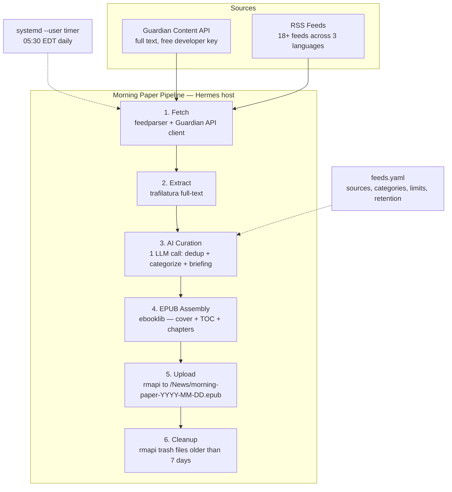

# remarkable-morning

Daily news digest pipeline for reMarkable Paper Pro. Fetches sources across EN/DE/FR, curates via LLM, builds a reflowable EPUB, and uploads to reMarkable Cloud via `rmapi`.

Every morning at 05:30 EDT, a Python pipeline fetches news from sources across 3 languages (EN/DE/FR), extracts full article text, runs a light AI curation pass (dedup + categorize + morning briefing), assembles a reflowable EPUB, uploads it to the reMarkable Paper Pro via `rmapi`, and trashes files older than 7 days. You read it with your coffee.

**Everything is configurable** — sources, languages, categories, article limits, per-source caps, retention, schedule, and LLM model are all set in `feeds.yaml`. Add or remove feeds, switch languages, tune the curation — no code changes needed. See [Configuration Reference](#configuration-reference) below.

## Architecture



## How It Works

The pipeline runs in 6 stages, each timed and logged:

1. **Fetch** — RSS feeds via `feedparser`, Guardian articles via the Content API (`httpx`). Failed sources are logged and skipped — one broken feed doesn't stop the pipeline.
2. **Extract** — Full article text via `trafilatura`. Guardian articles come with full text from the API; RSS articles get extracted from their HTML content with a URL fetch fallback.
3. **Curate** — A single LLM call to OpenRouter (`z-ai/glm-5.2`) sends only article metadata (title, source, URL, language, first 200 words, publish date). The LLM deduplicates stories across sources, categorizes them (World, Business and Fintech, AI and Tech, Politics, Opinion), and writes a 3-5 sentence morning briefing.
4. **EPUB Assembly** — `ebooklib` builds a reflowable EPUB with a cover page (title, date, briefing, TOC by category), one chapter per article (header with source/byline/date, full text body, source URL footer).
5. **Upload** — `rmapi put` uploads the EPUB to `/News/` on the reMarkable.
6. **Cleanup** — `rmapi ls` + `rmapi rm` trashes any EPUB older than 7 days.

## Repo Structure

```
remarkable-morning/
├── README.md
├── LICENSE                        # MIT
├── pyproject.toml                 # Python project, deps listed below
├── feeds.example.yaml             # Sanitized config (no API keys) for the public repo
├── src/
│   └── remarkable_morning/
│       ├── __init__.py
│       ├── config.py               # YAML loader + schema validation + Article dataclass
│       ├── sources/
│       │   ├── __init__.py
│       │   ├── rss.py              # feedparser-based RSS fetcher
│       │   └── guardian.py         # Guardian Content API client (httpx)
│       ├── extract.py              # trafilatura full-text extraction
│       ├── curate.py               # AI curation: dedup + categorize + briefing
│       ├── epub.py                 # ebooklib EPUB assembly
│       ├── upload.py               # rmapi subprocess to /News folder
│       ├── cleanup.py              # rmapi trash files older than 7 days
│       └── pipeline.py             # Orchestrates the full run
├── systemd/
│   ├── remarkable-morning.service  # systemd --user service unit
│   └── remarkable-morning.timer     # systemd --user timer unit (05:30 EDT)
└── tests/
    ├── test_config.py
    ├── test_sources.py
    ├── test_extract.py
    ├── test_curate.py
    ├── test_epub.py
    └── test_pipeline.py
```

## Prerequisites

### 1. reMarkable Paper Pro — Pair with rmapi

The `rmapi` tool needs a one-time auth code from `my.remarkable.com` to generate a `.rmapi` credential file.

```bash
# Install rmapi (ddvk/rmapi — actively maintained)
cd /tmp
wget https://github.com/ddvk/rmapi/releases/latest/download/rmapi-linux-amd64.tar.gz
tar xf rmapi-linux-amd64.tar.gz
sudo mv rmapi /usr/local/bin/
rmapi --version

# Pair (get one-time code at https://my.remarkable.com/device/desktop/connect)
rmapi
# First run prompts for the code — paste it in
# This creates ~/.rmapi with your auth token

# Verify and create /News folder
rmapi ls
rmapi mkdir /News
rmapi ls /News
```

### 2. Guardian Content API — Register for free key

1. Go to https://open-platform.theguardian.com/access
2. Click "Register developer key" under the Developer section
3. Fill in the form (name, email, project description — "personal news reader, non-commercial")
4. You'll receive an API key immediately

```bash
# Store the key
echo 'GUARDIAN_API_KEY=your-key-here' >> ~/.config/environment.d/remarkable-morning.conf
```

### 3. LLM API Key (for curation)

The curation pass uses an LLM API call via OpenRouter. The pipeline reads `OPENROUTER_API_KEY` from the environment.

```bash
echo 'OPENROUTER_API_KEY=your-key-here' >> ~/.config/environment.d/remarkable-morning.conf
```

## Installation

```bash
# Clone
git clone https://github.com/vevmesteren/remarkable-morning.git ~/remarkable-morning
cd ~/remarkable-morning

# Create virtual environment
python3 -m venv .venv
source .venv/bin/activate

# Install dependencies
pip install feedparser trafilatura ebooklib httpx pyyaml

# Copy and edit config
cp feeds.example.yaml feeds.yaml
# Edit feeds.yaml to add/remove sources, adjust limits

# Verify
python -m remarkable_morning.pipeline feeds.yaml
```

### Python Dependencies

| Package | Purpose |
|---------|---------|
| `feedparser` | RSS/Atom feed parsing |
| `trafilatura` | Full-text extraction from HTML |
| `ebooklib` | EPUB assembly |
| `httpx` | HTTP client for Guardian Content API |
| `pyyaml` | Config loading |

`rmapi` is a Go binary — installed separately (not a Python dep). Called via `subprocess`.

## Configuration Reference

The pipeline reads `feeds.yaml` (copy `feeds.example.yaml` as a starting point). API keys are **never** stored in this file — they are read from environment variables.

```yaml
schedule: "05:30"              # EDT, fired by systemd timer
remarkable_folder: "/News"
retention_days: 7
primary_language: en           # Language for the morning briefing

sources:
  - name: "The Guardian"
    type: guardian_api
    api_key_env: "GUARDIAN_API_KEY"  # Environment variable name
    sections: [world, business, technology, politics]
    limit: 15

  - name: "BBC News"
    type: rss
    feeds:
      - "http://feeds.bbci.co.uk/news/world/rss.xml"
      - "http://feeds.bbci.co.uk/news/business/rss.xml"
    limit: 10

  - name: "Der Spiegel"
    type: rss
    feeds: ["https://www.spiegel.de/index.rss"]
    limit: 8
    language: de               # Override per-source (defaults to primary_language)

curation:
  model: "z-ai/glm-5.2"        # OpenRouter model
  max_articles: 25             # Hard cap after dedup
  max_per_source: 5            # Max articles from any single source
  categories:
    - World
    - Business & Fintech
    - AI & Tech
    - Politics
    - Opinion
  briefing: true               # Generate 3-5 sentence morning briefing
  dedup: true                  # Cross-source deduplication
```

### Source Types

| Type | Required Fields | Description |
|------|-----------------|-------------|
| `rss` | `name`, `feeds`, `limit` | RSS/Atom feeds parsed with feedparser |
| `guardian_api` | `name`, `api_key_env`, `sections`, `limit` | Guardian Content API via httpx |

### Config Validation

The config loader validates:
- Required top-level keys: `sources`, `curation`
- Each source has a valid `type` (rss or guardian_api)
- RSS sources have non-empty `feeds`
- Guardian sources have `api_key_env`
- No duplicate source names

## systemd Setup

The pipeline ships with systemd --user unit files. These are **not** installed automatically — copy and enable them manually.

```bash
# Copy service + timer to systemd user directory
cp systemd/remarkable-morning.service ~/.config/systemd/user/
cp systemd/remarkable-morning.timer ~/.config/systemd/user/

# Reload and enable
systemctl --user daemon-reload
systemctl --user enable remarkable-morning.timer
systemctl --user start remarkable-morning.timer

# Verify
systemctl --user list-timers remarkable-morning.timer
# Should show next trigger: tomorrow 05:30 EDT

# Manual test run
systemctl --user start remarkable-morning.service
journalctl --user -u remarkable-morning.service -f
```

The service file expects environment variables `GUARDIAN_API_KEY` and `OPENROUTER_API_KEY` to be available. If using `EnvironmentFile`, add a line like:

```ini
EnvironmentFile=%h/.config/environment.d/remarkable-morning.conf
```

## Testing

```bash
# Install dev dependencies
pip install -e ".[dev]"

# Run all tests
pytest

# Run with verbose output
pytest -v
```

All tests use mocks — no network calls, no `rmapi` required.

## Manual Run

```bash
# Run the pipeline manually
python -m remarkable_morning.pipeline feeds.yaml

# Or with a custom output directory
python -m remarkable_morning.pipeline feeds.yaml /tmp/epubs
```

## EPUB Layout

```
┌─────────────────────────────────────┐
│         MORNING PAPER               │
│        Tuesday, November 10         │
│                                     │
│  "Here's what happened overnight.   │
│   Three sentences on the top        │
│   stories..."                       │
│  [AI morning briefing]              │
│                                     │
│  24 articles · 19 sources           │
│  EN · DE · FR                       │
│                                     │
│  ─── TABLE OF CONTENTS ───          │
│  World (8)                          │
│  Business & Fintech (5)             │
│  AI & Tech (4)                      │
│  Politics (4)                       │
│  Opinion (3)                        │
└─────────────────────────────────────┘

[Section: World]
  Article 1 — The Guardian
  By John Smith · Nov 10, 2026
  Also covered by: BBC News, CBC News
  ─────────────────────────────────
  [Full article text — reflowable]
  ─────────────────────────────────
  Source: https://theguardian.com/...
```

Each article is one EPUB chapter with a header (source, byline, date, also-covered-by), full text body (reflowable), and source URL footer.

## Retention

- One file per day: `morning-paper-YYYY-MM-DD.epub`
- Upload target: `/News/` folder on reMarkable
- Cleanup step trashes any file in `/News/` older than 7 days via `rmapi`
- No manual cleanup needed — read it, it's gone by next week

## Credits

- **jessfraz/morningpaper2remarkable** — original inspiration (syncs Adrian Colyer's "Morning Paper" blog to reMarkable)
- **ddvk/rmapi** — Go CLI for reMarkable Cloud API (actively maintained, v0.0.35)
- **Guardian Open Platform** — free developer Content API

## License

MIT
